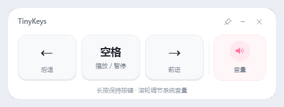

# TinyKeys

一个白色小面板，用鼠标完成 B 站网页视频的常用快捷键操作。

- **←**：左方向键（后退）
- **空格**：播放 / 暂停
- **→**：右方向键（前进）
- 鼠标滚轮停在右侧音量区：调节 Windows 系统音量
- 按住按钮 = 保持对应按键按下；松开鼠标才释放
- 右上角支持 **置顶（图钉）**、**最小化** 和 **关闭**



## 运行

从源码运行（需要 .NET 8 SDK）：

```powershell
dotnet run --project src\TinyKeys\TinyKeys.csproj
```

发布为单文件 exe 后，运行生成物：

```powershell
dotnet publish src\TinyKeys\TinyKeys.csproj -c Release -r win-x64 --self-contained false -p:PublishSingleFile=true -o dist
dist\TinyKeys.exe
```

发布物需要 .NET 8 Desktop Runtime。构建输出目录 `dist/` 不提交到仓库。

## 使用

1. 先点击一下 B 站视频页面，让浏览器成为最近使用的窗口。
2. 点击面板上的按钮；面板会短暂把浏览器切回前台并发送按键。
3. 按住左 / 右按钮会保持方向键按下，B 站会触发原生行为：左键快速回退，右键 2 倍速播放，松开鼠标后停止。
4. 移动鼠标到右侧音量区，上下滚动滚轮调节系统音量。
5. 拖动顶部标题区域移动面板；右上角图钉切换是否悬浮在最上层，`−` 最小化，`×` 退出。

默认不置顶；点图钉后按钮变粉色，面板会悬浮在其他窗口之上，再点一次取消。置顶状态只对当前运行有效，不写入配置。

如果 B 站窗口位于某块显示器，启动时面板会优先放到另一块显示器中央；否则放在鼠标所在显示器中央。

## 长按的实现

B 站的“长按右键 2 倍速”依赖的是按键保持状态，而不是连续点击。因此 TinyKeys 模拟的是物理键盘的完整按住过程：

- 鼠标按下时发送一次 `keydown`；
- 按住期间按 Windows 键盘重复延迟和速率继续发送 `keydown`，不发送 `keyup`；
- 松开鼠标时才发送一次 `keyup`。

这样 B 站会把整个按住过程识别为一次长按，而不是很多次短按。短按仍然是快速按下并释放。

**左键和右键共用同一套按住逻辑**，只有发送的虚拟键码不同（左键 `VK_LEFT`、右键 `VK_RIGHT`）。不存在左键一套、右键另一套的实现；B 站自己在收到按住的方向键后决定是快速回退还是 2 倍速。

参考资料：

- [B站新功能：键盘快捷操作！「短按快进」「长按倍速」](https://sj.qq.com/blog/1746605207000)
- [V2EX：B 站桌面端长按右键激活二倍速](https://global.v2ex.co/t/808104)
- [Golden-Right：按住键倍速、松开恢复的实现](https://github.com/SkyJinXX/Golden-Right)
- [B站快捷键说明：左/右键短按跳转，长按右键倍速、长按左键快速回退](https://blog.csdn.net/qq_37860634/article/details/124464965)

## 说明

- 只向浏览器窗口发送按键（Chrome、Edge、Firefox、Brave、Vivaldi、Opera、Chromium）。若最近的前台不是浏览器，底部会提示先点一下 B 站。
- 不读取网页、不注入脚本、不安装浏览器扩展、不联网。
- 音量是 Windows 系统音量，不是 B 站播放器内部音量。
- 仅支持已经获得焦点的 B 站视频页面；如果键盘焦点在地址栏或输入框，模拟按键会进入那个控件。

## 构建

```powershell
dotnet build TinyKeys.sln -c Release
dotnet publish src\TinyKeys\TinyKeys.csproj -c Release -r win-x64 --self-contained false -o dist
```

设计说明见 [docs/DESIGN.md](docs/DESIGN.md)。
