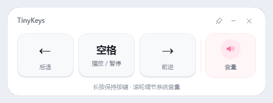

# TinyKeys

**版本** v1.1.2 · **状态** 已实现  
**用途** 一个白色小面板，把鼠标操作映射成 B 站网页播放器需要的键盘操作。



---

## 1. 功能

四个操作：

| 控件 | 实际发送 |
| --- | --- |
| 左按钮 | `←` |
| 中间按钮 | `Space` |
| 右按钮 | `→` |
| 音量区 | 鼠标滚轮 → Windows 系统音量加 / 减 |

窗口右上角包含图钉（切换置顶）、`−` 最小化和 `×` 关闭。

## 2. 界面

```text
┌──────────────────────────────────────────────────┐
│  TinyKeys                      图钉   −      ×   │
│                                                  │
│     ←          空格            →          🔊     │
│   后退         播放/暂停        前进       音量    │
│                                                  │
│         长按保持按键 · 滚轮调节系统音量             │
└──────────────────────────────────────────────────┘
```

- 白色卡片，约 440 × 152 DIP，圆角、细描边、柔和阴影。
- 三个浅灰色键帽按钮；右侧是浅粉色音量区。
- 默认不置顶；点图钉后切换为悬浮最上层，按钮进入粉色选中态。
- 可拖动、可最小化、可关闭，出现在任务栏。
- 没有托盘图标；关闭即退出。置顶状态不持久化。

## 3. 按键行为

### 短按

鼠标按下时发送 `keydown`，松开鼠标时发送 `keyup`，对应一次普通键盘敲击。

### 长按

B 站桌面端支持“短按右键快进、长按右键 2 倍速、松开恢复”，这个功能依赖按键保持状态，而不是连续点击。因此实现为：

1. 鼠标按下后发送一次 `keydown`；
2. 按住期间，按 Windows 键盘重复延迟继续发送 `keydown`，期间不发 `keyup`；
3. 松开鼠标时只发送一次 `keyup`。

按住左键、空格、右键都使用这套完整按住语义，具体效果由 B 站播放器决定。B 站原生于长按右键进入 2 倍速，长按左键快速回退；松开鼠标后恢复，而不是连续短按产生一串独立跳转。

**左右键没有两套实现**：两者都进入同一个 `StartHold`，走同一套 `keydown` 重复与 `keyup` 释放逻辑，唯一区别是发送的虚拟键码不同（`VK_LEFT` / `VK_RIGHT`）。

参考资料：

- [B站新功能：键盘快捷操作！「短按快进」「长按倍速」](https://sj.qq.com/blog/1746605207000)
- [V2EX：B 站桌面端长按右键激活二倍速](https://global.v2ex.co/t/808104)
- [Bilibili-Evolved 关于原生长按右键倍速的讨论](https://github.com/the1812/Bilibili-Evolved/discussions/5113)
- [Golden-Right：按住键倍速、松开恢复的实现](https://github.com/SkyJinXX/Golden-Right)
- [B站快捷键说明：长按右键倍速、长按左键快速回退](https://blog.csdn.net/qq_37860634/article/details/124464965)

### 目标窗口

- 点击按钮时，程序先把**最近一次使用过的浏览器窗口**切回前台，再发送按键。
- 只接受浏览器进程（Chrome / Edge / Firefox / Brave / Vivaldi / Opera / Chromium）。如果最近的前台不是这些浏览器，底部提示“请先点一下 B 站视频”。
- 目标窗口失去前台、窗口最小化、鼠标松开或程序退出时，会补发 `keyup`，避免按键状态卡住。

## 4. 音量

- 指针停在音量区上，向上滚轮发送音量加键，向下滚轮发送音量减键。
- 调节 Windows 系统音量，使用系统音量提示条反馈；不调整 B 站播放器内部音量。
- 音量滚轮通过低级鼠标钩子处理，不要求 TinyKeys 处于焦点；在音量区滚动时会吞掉滚轮，避免同时滚动网页。

## 5. 窗口

- 启动时如果检测到浏览器在某个显示器上，优先把面板放到另一块显示器中央；否则放在鼠标所在显示器中央。
- 不记忆位置，每次启动重新定位。
- 拖动标题栏移动；图钉切换置顶；`−` 最小化；`×` 退出。
- 最小化期间暂停按键/音量交互，恢复后可用。
- 图钉只控制当前窗口的 `Topmost`；置顶时通过 `SetWindowPos(HWND_TOPMOST, SWP_NOACTIVATE)` 提到最上层，不抢 B 站焦点。取消后恢复正常窗口层级。

## 6. 实现

- C# / .NET 8 / WPF，单个项目，无第三方 NuGet 包。
- `SendInput` 发送键盘按下、自动重复和抬起事件。
- `SPI_GETKEYBOARDDELAY` / `SPI_GETKEYBOARDSPEED` 获取系统按键重复节奏。
- `SetWinEventHook` 记住最近一次外部前台窗口。
- 低级鼠标钩子（`WH_MOUSE_LL`）处理音量区滚轮，并阻止下层页面收到该滚轮。
- 无网络请求，不需要管理员权限。

## 7. 已知边界

- 需要先让 B 站页面成为“最近使用的浏览器窗口”，程序才知道按键发给谁。
- 只识别浏览器窗口；其他程序不会收到模拟按键，避免误操作。
- 不显示播放状态、进度或音量数值。
- 音量是浏览器所在进程之外的 Windows 系统音量。
- 默认不置顶；如果被其他窗口挡住，用任务栏切回，或点图钉把它钉在最上层。

## 8. 验收

- 点击左 / 中 / 右按钮，B 站视频分别后退、暂停/播放、前进。
- 长按右按钮进入 B 站原生的 2 倍速播放，松开鼠标恢复原速；不是多次离散跳转。
- 鼠标悬停音量区滚动，Windows 系统音量变化，网页不滚动。
- 右上角 `−` 能把窗口最小化，并可从任务栏恢复；`×` 退出。
- 右上角图钉能在置顶/普通层级之间切换；选中时按钮变粉，且不会抢走 B 站焦点。
- 双屏下默认不与浏览器在同一块屏幕上。
